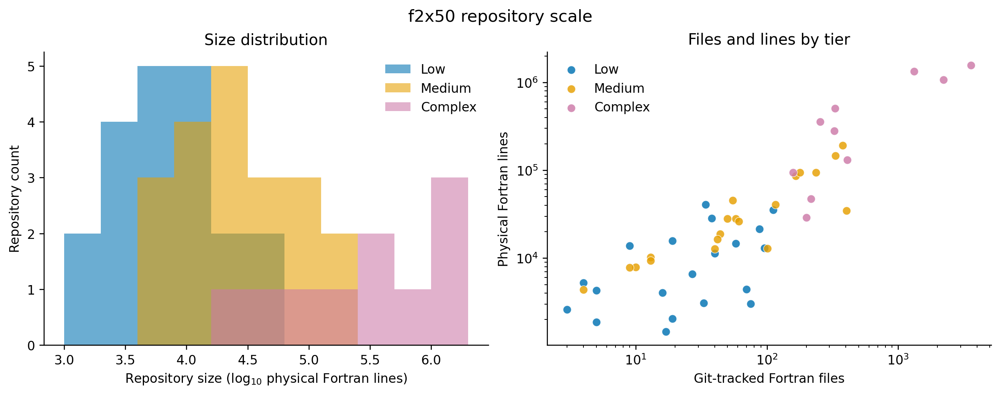

# f2x50

**f2x50** is a repository-scale benchmark for migrating Fortran software to a target language or platform **X**. It fixes 50 public Fortran repositories at exact Git revisions, stratifies them into three structural-complexity tiers, and provides 559 versioned behavioral contracts linked to those repositories. A source-information manifest distinguishes direct pinned-source execution from text-matched extractions, inline reimplementations, and synthetic fixtures.

The benchmark is not restricted to Fortran-to-Python migration. Its source side and probe catalogue are target-independent; the included executable adapter currently compares Fortran-side contracts with Python targets and serves as the first reference implementation.

| Tier | Repositories | Git-tracked Fortran files | Physical Fortran lines | Probes |
|---|---:|---:|---:|---:|
| Low | 20 | 768 | 233,077 | 203 |
| Medium | 20 | 2,313 | 916,989 | 199 |
| Complex | 10 | 9,035 | 5,419,740 | 157 |
| **Total** | **50** | **12,116** | **6,569,806** | **559** |



## What is included

- [`manifests/repositories.csv`](manifests/repositories.csv): original repository URLs, immutable revisions, reproducible size measurements, domains, and licence information.
- [`manifests/probes.csv`](manifests/probes.csv): stable identifiers and comparison modes for all 559 planned probes, without results from any migration method.
- [`manifests/source_information.csv`](manifests/source_information.csv): source category, original repository file and routine, line range, and executable definition for every check.
- [`harness/`](harness): Fortran oracle sources and the Python-target reference adapter.
- [`clone_corpus.sh`](clone_corpus.sh): deterministic acquisition of exact revisions without redistributing the original repositories.
- [`scripts/validate.py`](scripts/validate.py): integrity checks for cardinalities, identifiers, joins, and pinned revisions.
- [`scripts/make_figures.py`](scripts/make_figures.py): reproducible descriptive figures for papers and dataset reports.
- [`docs/dataset-card.md`](docs/dataset-card.md): scope, repository origins, intended uses, limitations, and maintenance policy.

## Quick start

Validate the release using only the Python standard library:

```bash
python scripts/validate.py
python scripts/summarize.py
python scripts/summarize_coverage.py
```

Acquire the recorded revisions of all 50 original repositories with the shell script. Use `--repo` for a single repository:

```bash
bash clone_corpus.sh
bash clone_corpus.sh --repo roots-fortran
bash clone_corpus.sh --verify-only --repo roots-fortran --check-metrics
```

An explicit destination may be supplied either positionally (`bash clone_corpus.sh /path/to/corpus`) or with `--destination`. The script reads URLs, directory names, full Git SHAs, and expected measurements from `manifests/repositories.csv`; it does not maintain a second hard-coded repository list.

Regenerate the figures after installing Matplotlib:

```bash
python -m pip install -r requirements-figures.txt
python scripts/make_figures.py
```

The complete corpus is several gigabytes and includes projects with external build dependencies. Acquisition therefore verifies revisions but does not imply that every original project builds on every host.

For a clean-room smoke test that acquires one pinned repository, verifies its metrics, compiles every checked-in `f2py` wrapper, and runs a complete source-to-target tutorial probe:

```bash
python -m venv .venv
. .venv/bin/activate
python -m pip install -r requirements-harness.txt
bash scripts/cleanroom_smoke.sh /tmp/f2x50-corpus
```

See [`docs/cleanroom-replay.md`](docs/cleanroom-replay.md) for the tested toolchain and result. A `Dockerfile` provides the same sequence on a minimal Linux image.

## Benchmark boundary

The benchmark is defined by the repository, probe, and source-information manifests together with the executable checks. Target adapters connect Python, Julia, C++, Rust, or other implementations to the same 559 checks. Of these, 444 compile exact files from the pinned original repositories with small drivers. All 50 repositories have at least five such checks; 49 repositories execute at least two distinct pinned routines. The 444 direct checks cover 130 repository-routine pairs, compared with 12 directly covered repositories in the 382-probe development snapshot. The [direct-source expansion audit](docs/direct-source-expansion-audit.md) records the predeclared selection rules, exact source routines, feasibility exclusion, and interface-only dependency stubs.

The repository does **not** include copies of the 50 original codebases. Each remains governed by its own licence. The licence check found 47 pins with an unambiguous project-level expression, one mixed/ambiguous case (`Cmathtuts`), and two with no explicit licence (`ABAQUS` and `MPM3D-F90`). The latter three are marked `NOASSERTION`. See [`docs/licensing.md`](docs/licensing.md) before redistribution.

## Citation

Use [`CITATION.cff`](CITATION.cff). A versioned archival DOI should be added to that file when the first public release is deposited.

## Prior public use

An earlier 382-probe development snapshot was used to compare five repository-migration configurations across all 50 pins in [*Identifying Latent Declarative Representations of Code for Assisting Repository Migration*](https://doi.org/10.48550/arXiv.2608.23619). This is a public use case by overlapping authors, not independent external adoption; version 0.2 strengthens the source evidence and changes the denominator to 559.

## Licence

Repository code is licensed under Apache-2.0 in [`LICENSE`](LICENSE). The benchmark manifests and original documentation are licensed under CC BY 4.0 in [`LICENSE-DATA.md`](LICENSE-DATA.md). These licences do not replace the licences of the original repositories.
