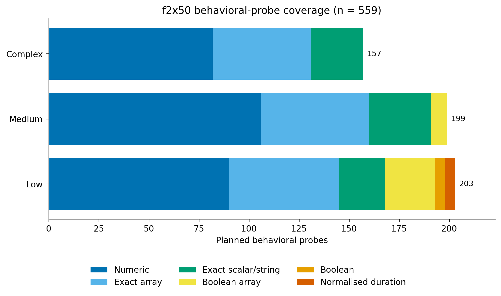
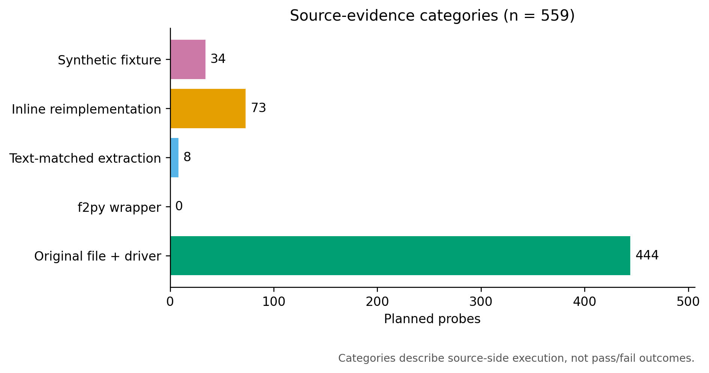

# Behavioral probes

## Catalogue and executable definitions

`manifests/probes.csv` is the stable, target-independent catalogue. Each row identifies the source repository, case label, comparison mode, oracle type, and file containing the executable definition. Stable probe identifiers are assigned within repository and tier; case labels need not be globally unique.

The manifest deliberately contains no `pass`, `fail`, `max_abs`, or `max_rel` columns. Those values describe one migration method at one point in time and belong in an evaluation-results package.

The executable definitions are split between:

- `harness/python/run_corpus_verification.py`, which contains the original reference verifiers; and
- `harness/python/extended_repo_verifiers.py`, which extends coverage to the complete 50-repository set.

The other Python files inventory candidates and support automated probes. `harness/fortran_stubs/` contains seven small Fortran sources retained for compatibility and development. Version 0.2's released provenance audit contains no `f2py-wrapper` cases: direct cases compile pinned repository files with standalone drivers. Generated `.so` and `.mod` files must not be committed.

## Fortran-side execution and source information

The reference adapter requires a Fortran compiler, NumPy, and the pinned source corpus. Repository-specific verifier functions provide deterministic inputs, parse source-side output, and call the corresponding target behavior. The source side is not uniform: some checks compile a pinned file, some use checked-in `f2py` wrappers, some compile an inline reimplementation of a selected behavior, and some use a deliberately synthetic fixture. These categories are recorded per check in `manifests/source_information.csv`; they must not be collapsed into the claim that every check executes original upstream source.

The harness reads these environment variables:

```bash
export F2X_FORTRAN_CORPUS_ROOT=/path/to/corpus
export F2X_TARGET_ROOT=/path/to/python/targets
python harness/python/run_corpus_verification.py
```

`F2X_TARGET_ROOT` identifies the Python implementations under evaluation. A new target-language adapter may replace the target loader while retaining the same source programs, inputs, comparison mode, and tolerances.

## Coverage



| Comparison mode | Probes |
|---|---:|
| Numeric tolerance | 278 |
| Exact array | 158 |
| Exact scalar/string | 80 |
| Exact Boolean array | 33 |
| Exact Boolean | 5 |
| Normalized duration | 5 |
| **Total** | **559** |

Tier totals are 203 low, 199 medium, and 157 complex probes. Every repository has at least five planned probes and at least five `original-file-plus-driver` probes. The 444 direct cases cover 130 repository-routine pairs, and 49 repositories execute at least two distinct pinned routines. Relative to the 382-probe development snapshot, version 0.2 adds 177 checks and raises direct pinned-source execution from 75 to 444 checks across all 50 repositories.



The release-level and per-repository density analysis is in [`coverage-audit.md`](coverage-audit.md). Its deterministic 50-probe sample is an optional checklist for future external review; version 0.2 makes no claim of independent validation.

## Adding another target adapter

An adapter should resolve each `probe_id` to a callable in the migrated repository, provide exactly the fixed input, normalize only as specified by the executable definition, and return a value to the common comparator. Repository-specific name mappings are permitted when the migration changes API spelling, but must be declared before outcomes are examined and applied consistently to every compared method.
